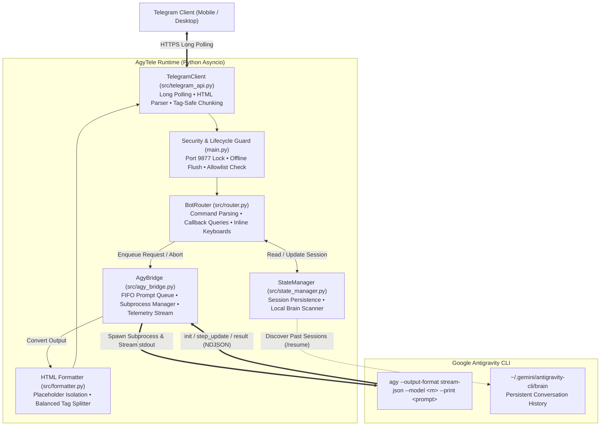

<div align="center">

<pre align="center">
               ▄▄
              ████▄▄
             ██  ▀████▄▄
            ██      ▀████▄▄
           ██   ▄▄    ▀████▄
          ██   ████     ▀███
         ██   ███▀██      ▀█
        ██   ███   ▀█
       ██   ███
      ▀▀   ▀▀

 █████╗   ██████╗ ██╗   ██╗    ████████╗███████╗██╗     ███████╗
██╔══██╗ ██╔════╝ ╚██╗ ██╔╝    ╚══██╔══╝██╔════╝██║     ██╔════╝
███████║ ██║  ███╗ ╚████╔╝        ██║   █████╗  ██║     █████╗  
██╔══██║ ██║   ██║  ╚██╔╝         ██║   ██╔══╝  ██║     ██╔══╝  
██║  ██║ ╚██████╔╝   ██║          ██║   ███████╗███████╗███████╗
╚═╝  ╚═╝  ╚═════╝    ╚═╝          ╚═╝   ╚══════╝╚══════╝╚══════╝
</pre>

<p align="center">
  <strong>Pure Python Async Telegram Bridge for Google Antigravity CLI (agy)</strong>
</p>

<p align="center">
  <a href="https://www.python.org/"></a>
  <a href="#key-features"></a>
  <a href="#system-architecture"></a>
  <a href="#key-features"></a>
  <a href="https://core.telegram.org/bots/api"></a>
  <a href="#quick-start"></a>
</p>

<p align="center">
  <a href="#overview">Overview</a> &bull;
  <a href="#key-features">Key Features</a> &bull;
  <a href="#technical-specifications">Specifications</a> &bull;
  <a href="#system-architecture">System Architecture</a> &bull;
  <a href="#live-telemetry-interface">Live Telemetry</a> &bull;
  <a href="#quick-start">Quick Start</a> &bull;
  <a href="#telegram-command-reference">Commands</a> &bull;
  <a href="#project-structure">Project Structure</a> &bull;
  <a href="#verification-and-testing">Testing</a>
</p>

</div>

---

## Overview

AgyTele is a lightweight, zero-dependency async Telegram bridge designed specifically for the Google Antigravity CLI (`agy`). Written entirely in standard Python 3.10+ using `asyncio`, it bridges your local AI coding assistant directly to your mobile and desktop Telegram clients.

AgyTele interacts with `agy` using native `--output-format stream-json` over an asynchronous stdout pipe. It parses structured NDJSON telemetry events in real time, reports active tool calls directly to your smartphone, renders interactive inline keyboards for model and workspace switching, and enforces strict single-instance mutual exclusion without requiring third-party runtime dependencies.

---

## Key Features

<table>
  <thead>
    <tr>
      <th width="50%">Capability</th>
      <th width="50%">Technical Implementation</th>
    </tr>
  </thead>
  <tbody>
    <tr>
      <td>
        <strong>Native Stream-JSON Event Streaming</strong><br />
        Direct bidirectional communication with the Antigravity CLI process.
      </td>
      <td>
        Spawns <code>agy --output-format stream-json</code> over an async 16MB stdout pipe. Parses raw NDJSON frames (<code>init</code>, <code>step_update</code>, <code>result</code>) into typed events with zero ANSI regex stripping or disk file polling.
      </td>
    </tr>
    <tr>
      <td>
        <strong>Zero External Dependencies</strong><br />
        Runs instantly on any standard Python environment.
      </td>
      <td>
        Engineered exclusively using Python standard library modules: <code>asyncio</code>, <code>urllib.request</code>, <code>json</code>, <code>socket</code>, <code>pathlib</code>, and <code>re</code>. No <code>pip install</code> step, no native compilation requirements, and no virtual environment overhead.
      </td>
    </tr>
    <tr>
      <td>
        <strong>Live Tool Execution Telemetry</strong><br />
        Real-time visibility into internal agent operations.
      </td>
      <td>
        Tracks active tool calls (file reading, editing, shell commands, code search, and subagent orchestration) as they occur. Displays dynamic progress in an in-place updating Telegram card accompanied by an instant task cancellation button.
      </td>
    </tr>
    <tr>
      <td>
        <strong>Interactive Inline Keyboards</strong><br />
        Full CLI control directly from touch screens.
      </td>
      <td>
        Interactive Telegram menus allow users to dynamically switch AI models (<code>/model</code>), change workspaces across detected Git repositories (<code>/workspace</code>), resume prior conversations from local storage (<code>/resume</code>), and toggle agent autonomy modes (<code>/mode</code>).
      </td>
    </tr>
    <tr>
      <td>
        <strong>Deterministic HTML Formatter and Splitter</strong><br />
        Compliant formatting for Telegram Bot API limitations.
      </td>
      <td>
        Protects Markdown code blocks and technical identifiers (such as <code>__init__</code> and <code>*args</code>) via cryptographic placeholder isolation. Automatically splits responses exceeding 4,000 characters while programmatically tracking and rebalancing nested HTML tags across chunk boundaries.
      </td>
    </tr>
    <tr>
      <td>
        <strong>Local Security and Lifecycle Management</strong><br />
        Engineered for safe personal workstation usage.
      </td>
      <td>
        Binds a localhost TCP lock on port <code>9877</code> to prevent duplicate background processes. Enforces an explicit numeric Telegram user ID allowlist, purges accumulated offline updates on launch, and cleanly terminates active child processes on terminal shutdown.
      </td>
    </tr>
  </tbody>
</table>

---

## Technical Specifications

AgyTele is engineered for deterministic, lightweight execution without background bloat or runtime overhead:

| System Component | Implementation Pattern | Technical Advantage |
| :--- | :--- | :--- |
| **CLI Protocol** | Native `--output-format stream-json` over an async 16MB stdout pipe | Structured NDJSON event streaming without terminal scraping, ANSI stripping, or heuristic completion timeouts |
| **Tool Telemetry** | Direct interception of `step_update` (`state="ACTIVE"`) stream events | Sub-millisecond telemetry delivery directly from stdout rather than polling disk-backed transcript files |
| **Model Discovery** | Asynchronous execution of `agy models` via `asyncio.create_subprocess_exec` | Dynamic parsing of CLI models rendered directly into responsive Telegram inline keyboards |
| **Runtime Footprint** | Exclusively Python standard library (`asyncio`, `urllib.request`, `socket`, `pathlib`) | Zero external dependencies; no package installations, no binary compilation, and instant cold startup |
| **Process Interruption** | Signal-based subprocess management (`SIGINT`/`SIGTERM`/`SIGKILL`) | Instant task cancellation from Telegram clients via `/stop` or the inline stop button |
| **Workspace Routing** | Dynamic directory resolution and Git repository detection | On-the-fly project switching via `/workspace` and `/cd` without restarting the process |
| **Execution Lifecycle** | On-demand terminal-bound lifecycle with startup update flush | Flushes stale offline messages before processing commands and shuts down cleanly on terminal exit |

---

## System Architecture



---

## Live Telemetry Interface

When a coding task is dispatched, AgyTele updates a single transient status card in place as internal tools execute, eliminating notification spam. Once the agent completes its response, the telemetry card is removed and replaced by the final formatted message:

```text
+--------------------------------------------------------------+
| Antigravity is executing tools...                            |
|                                                              |
| Recent Activity:                                             |
|   - Browse directory: src                                    |
|   - Search codebase: def markdown_to_telegram_html           |
|   - Read file: formatter.py                                  |
|   - Update file: test_core.py                                |
|   - Run command: python -m unittest discover -s tests        |
|                                                              |
|          [ Stop Running Task ]                               |
+--------------------------------------------------------------+
```

---

## Quick Start

### Prerequisites

1. **Python 3.10 or higher** installed on your workstation.
2. **Google Antigravity CLI (`agy`)** installed and authenticated in your system `PATH` (validate using `agy --version`).
3. A **Telegram Bot Token** obtained from [@BotFather](https://t.me/BotFather).
4. Your numeric **Telegram User ID** obtained from [@userinfobot](https://t.me/userinfobot).

### 1. Clone the Repository

```bash
git clone https://github.com/huuan26/AgyTele.git
cd AgyTele
```

### 2. Run Interactive Configuration

Launch the guided terminal setup wizard to generate `config.json`:

```bash
python setup.py
```

The wizard prompts for four parameters:
- **Telegram Bot Token**: Your API token (input is masked for security).
- **Allowed User IDs**: Comma-separated list of numeric Telegram IDs permitted to access the bot.
- **Default Workspace**: Base directory for agent execution (defaults to your home path).
- **Default AI Model**: Initial model target (e.g., `gemini-4-argon-high`).

<details>
<summary><strong>Manual Configuration Reference (config.json)</strong></summary>

Alternatively, create `config.json` manually in the project root:

```json
{
  "bot_token": "1234567890:AAH_YOUR_TELEGRAM_BOT_TOKEN_HERE",
  "allowed_user_ids": [
    123456789
  ],
  "default_workspace": "C:\\Users\\ADMIN\\Documents",
  "default_model": "gemini-4-argon-high",
  "permission_mode": "auto"
}
```

The configuration path can also be overridden using the `ANTI_TELE_CONFIG` environment variable.

</details>

### 3. Launch the Bridge

**Windows (One-Click Launcher):**
Double-click `run.bat`. The script verifies that Python is available, checks for `config.json`, triggers `setup.py` automatically if missing, and starts the service.

**Terminal (Cross-Platform):**
```bash
python main.py
```

- **Startup sequence**: Clears pending Telegram updates sent while the machine was offline, registers bot menu commands, binds port `9877`, and delivers an online status message to the primary authorized user.
- **Shutdown sequence**: Catches termination signals (`SIGINT` / `Ctrl + C`), terminates any running `agy` child process, cleans up sockets, and issues a final offline notification.

---

## Telegram Command Reference

All commands are automatically registered in the Telegram Bot client menu upon connection:

| Command | Syntax | Description | Interface |
| :--- | :--- | :--- | :--- |
| `/new` | `/new [prompt]` | Clears conversation state and initiates a new session (optionally executing an initial prompt immediately) | Text |
| `/resume` | `/resume [index]` | Scans local CLI brain directory and lists recent sessions for resumption | Inline Keyboard |
| `/model` | `/model [id]` | Queries available models via `agy models` and provides instant selection | Inline Keyboard |
| `/workspace` | `/workspace [path]` | Displays current working directory, lists discovered local Git repositories, or changes location | Inline Keyboard |
| `/mode` | `/mode [mode]` | Configures execution permission profile: `auto`, `accept-edits`, or `plan` | Inline Keyboard |
| `/goal` | `/goal <objective>` | Dispatches an autonomous multi-step execution goal to the agent | Text |
| `/stop` | `/stop` | Terminates active child processes and flushes pending prompts in the queue | Button / Text |
| `/usage` | `/usage` | Reports session token consumption, turnaround latency, and turn counters | Text |
| `/status` | `/status` | Displays host operating system, Python version, active model, mode, and session ID | Text |
| `/help` | `/help` | Prints the complete quick reference manual | Text |

### Prompt Queue Management

When multiple messages are submitted while an existing CLI operation is executing, AgyTele places new prompts into a per-chat First-In, First-Out (FIFO) queue (`#1`, `#2`, ...). Each queued request is dispatched sequentially as the preceding run concludes, preserving conversation continuity without dropped prompts or interleaved output.

---

## Project Structure

```text
AgyTele/
├── assets/
│   └── agy_tele_pixel.svg      # Scalable pixel art header banner
├── data/
│   └── sessions.json           # Local session persistence store
├── src/
│   ├── __init__.py             # Package declaration
│   ├── agy_bridge.py           # Async subprocess orchestration and NDJSON parser
│   ├── config.py               # Configuration loader and schema validation
│   ├── formatter.py            # Code-safe Markdown-to-HTML parser and tag balancer
│   ├── router.py               # Telegram command router and inline callback processor
│   ├── state_manager.py        # Persistent session manager and brain scanner
│   └── telegram_api.py         # Zero-dependency async HTTP Telegram API client
├── tests/
│   └── test_core.py            # Unit test suite for parsing, formatting, and state
├── config.example.json         # Reference configuration template
├── main.py                     # Application entry point, socket lock, and lifecycle
├── run.bat                     # Windows batch launcher
└── setup.py                    # Guided interactive configuration CLI
```

---

## Verification and Testing

The project includes unit tests covering HTML entity conversion, code placeholder preservation, tag-balanced message chunking, tool telemetry status line generation, and session state persistence.

Execute tests using Python's native test runner:

```bash
python -m unittest discover -s tests -v
```

---

<div align="center">

**AgyTele &bull; Google Antigravity CLI Telegram Bridge**  
Maintained by [huuan26](https://github.com/huuan26)

</div>
